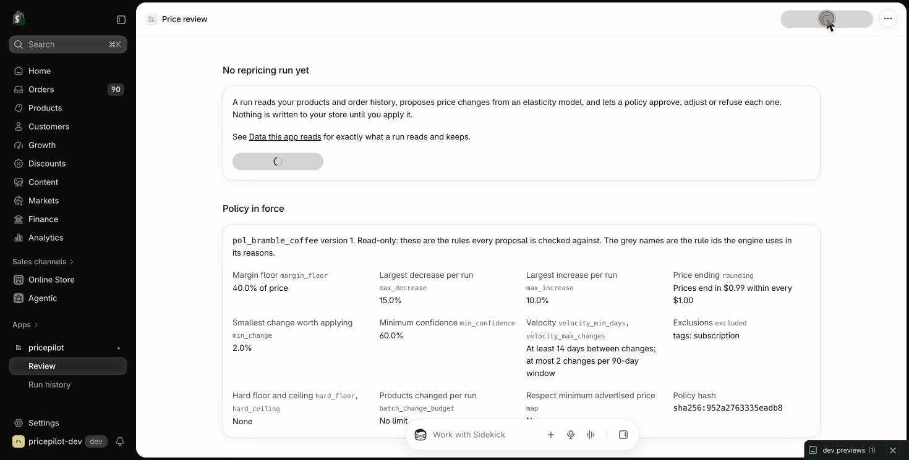

# PricePilot

**Repricing for Shopify in which a model proposes prices and a deterministic policy engine decides. The agent suggests, the rules decide, and every run can be undone.**

<p align="center">
  <a href="https://youtu.be/ncczuPv6ABM"></a>
</p>

<p align="center">
  <a href="https://youtu.be/ncczuPv6ABM"></a>
</p>

*A silent clip from **[the film](https://youtu.be/ncczuPv6ABM)**: 92 seconds, narrated, a paper collage drawn frame by frame by the code in [`film-collage/`](film-collage/README.md), with the real app in the middle of it.*

What is and is not real in it: the coffee stall, the bird and the rulebook are an illustration of how PricePilot works. The six photographs of a screen are unretouched screenshots of the app from one run on a Shopify development store: preview, apply, roll back. The order history behind that run is synthetic, and the app says so on screen. The narration is a synthetic voice, and the music and sound effects are synthesised by the same code. The figure the film opens on (a 1% change in price moves operating profit by 11%) is from Marn and Rosiello, *Harvard Business Review*, 1992: an average over 2,463 large companies with volume held constant. It says how sensitive profit is to price. It is not a claim about Shopify merchants or about what PricePilot achieves.

## What it is

An embedded Shopify app and the Go engine behind it.

1. The app reads the catalog and order history through the Admin GraphQL API.
2. The **estimator** (Go) fits a price elasticity per product and proposes a price, or declines. On most products it declines, and says why.
3. The **enforcer** (Go) checks each proposal against the merchant's policy: margin floor, largest change per run, how often a price may move, exclusions, price endings. It approves, adjusts or refuses, and names the rule that decided.
4. The merchant reviews the run, refusals first. Applying writes the prices, then re-reads them from Shopify to verify. Rolling back restores every prior price and verifies again.

Merchants are right to be afraid of an agent that changes prices. So the two halves are held to different standards:

- **[`pricing/`](pricing)** is probabilistic. It is judged statistically: does it recover a known elasticity, do its intervals cover what they claim, does it decline when the data cannot support an answer?
- **[`enforcer/`](enforcer)** is absolute. It is judged by invariants that must hold on every input, and a fuzzer attacks them.

No estimate, however wrong, can produce a price that breaks the merchant's policy. And no pricing logic exists in TypeScript: the app parses, stores and displays, and every number it writes to Shopify is one the Go engine returned.

<p align="center">
  
</p>

## What is proven

| Claim | Evidence |
|---|---|
| The enforcer's seven invariants hold on every input the fuzzer tried | 62.5M fuzz executions in 10 minutes, 0 violations ([details](enforcer/README.md)); 49 discovered corpus entries committed as regression cases |
| The app writes what the engine decided, and can undo it | On a Shopify development store on 2026-11-18, against 90 days of seeded orders: the preview matched the engine run directly on the same data for all 13 products; apply changed exactly the 5 intended prices; rollback restored all 13; and a run made straight after the rollback was refused by the 14-day rule. Prices were read from Shopify outside the app before and after each step. How to repeat it: [`shopify-app/README.md`](shopify-app/README.md) |
| The app adds no pricing logic of its own | 250 random requests through the JSON bridge match the enforcer's direct output byte for byte (`bridge/`); the app reaches the engine through one file, [`engine.server.ts`](shopify-app/app/services/engine.server.ts), and fails closed if the binary is missing |
| Elasticity is recovered from data whose truth is known | 2.0%–6.7% error across four known elasticities, at about 45 units a day per SKU (`TestRecoversKnownElasticity`) |
| The confidence intervals mean what they say, at the volume tested | 94.8% coverage on a stated 95% interval, over 600 trials at about 45 units a day per SKU |
| The estimator knows where it stops working | It refuses below 45 units a day per SKU, a floor set by a 330,000-trial sweep with the pass rule fixed in advance ([output](pricing/testdata/volume_sweep.txt)) |
| Pooling helps thin histories | 56% MSE reduction across 40 sparse SKUs |
| What it does on real sales is measured, not assumed | On 1.07 million real transaction lines it answers for 63 of 4,707 products, and the same run shows why those answers are suspect: on the same day, the cheaper lines of a product were the bigger orders ([output](pricing/testdata/realdata_online_retail_ii.txt)) |
| Omitting a confounder has a price | one missing promo control underprices by 26.8% |
| The docs match the code | The output blocks quoted in the READMEs are checked against the commands' real output on every push (`golden_test.go`) |

Five defects were found by reviewing this project's own output rather than by a user, and each is now a test: a proposed cut that the enforcer turned into a rise, rounding that carried a change past what the model asked, a cooldown that depended on the server's time zone, an estimator that was confidently wrong on slow sellers, and a README whose numbers had drifted from the code. The write-ups are in [`enforcer/`](enforcer/README.md) and [`pricing/`](pricing/README.md).

## The engine on its own

```bash
go run ./cmd/pipeline
```

Excerpts from its output (the catalog is synthetic and seeded, so every run prints the same thing; a test fails if these lines stop matching it):

<!-- golden: pipeline -->
```
    9 proposals generated; 4 SKUs produced none

      · Chemex Classic 6-cup         sold at 1 distinct price(s); elasticity needs at least 3
      · Hario V60 Filters 100ct      sold at 2 distinct price(s); elasticity needs at least 3
      · Signature Roast Mug          interval [-0.76, -0.50] reaches the inelastic region where no profit-maximising price exists
      · Travel Tumbler 350ml         no unit cost on this variant, so there is no margin to optimise

  funnel:  13 SKUs  →  11 estimable  →  9 proposals  →  7 applied
  of those applied, 2 were held back by a guardrail and 5 took the model's price
  proposals refused outright, by rule:  infeasible_bounds×1  min_change×1
```

Six of thirteen SKUs end with no price change: four never produce a proposal, and the enforcer refuses two more. One is a cut on a SKU already priced below its margin floor; the other is a move too small to be worth making. On a real catalog that ratio would be far higher, and it is the product working correctly rather than failing. In this command "applied" means cleared for a merchant's preview; only the app writes to a store.

## What is not claimed

**No revenue lift.** Proving lift requires a live A/B on a real store, and no number in this repo is one.

**No evidence that it prices real products well, and some that it would not.** `go run ./cmd/realdata` runs the estimator, exactly as shipped, on a real retailer's transactions: UCI Online Retail II, 1.07 million lines from a UK online gift seller, with the cleaning rules fixed before any estimate was computed ([output](pricing/testdata/realdata_online_retail_ii.txt)).

- It answers for 63 of 4,707 products (1.3%), which sold 19.5% of the units. The volume gate alone refuses 57%. With the gate off it would have answered for 2,396.
- Those 63 answers should not be trusted either. This retailer sells to wholesalers, and 45% of units sold on days when the same product went at more than one price. On 84% of those product-days, the lines at the day's lowest price were the larger ones. A day's price and a day's volume both depend on who happened to order, and the model has no control for it.
- The refusal for an implausible sign fired three times. This confounder pushes the slope in the plausible direction, so nothing in the estimator catches it.

Real data has no known true elasticity, so this run cannot say any estimate is right or how wrong it is. It says the method, as built, is not safe to point at a wholesale catalog.

**The app has only ever run on synthetic orders.** The order history on the development store is synthetic: generated from a known demand curve with a fixed seed, tagged `pricepilot-synthetic` on every order, and labelled on the review screen, which shows each estimate beside the true value it was generated from. It proves the Shopify integration, not the estimator. The estimator is shown to recover a known elasticity on synthetic orders, which is the only setting where recovery *can* be shown; real demand is non-stationary, cross-elastic and full of stockouts.

**Nothing about slow-selling products.** The log-log estimator goes wrong when daily unit counts are small, and its intervals do not warn you. From `go run ./cmd/sweep` (10,000 synthetic trials per row, true elasticity −3):

| Units a day per SKU | 95% interval actually covers | Bias in the estimate |
|---|---|---|
| 183 | 95.0% | 0.3% |
| 46 | 93.3% | 1.5% |
| 23 | 90.9% | 3.1% |
| 11 | 87.2% | 5.5% |
| 3.4 | 62.5% | 15.5% |
| 2.3 | 8.3% | 32.4% |

So the estimator refuses any SKU averaging under 45 units a day (`volume_too_low`). On a store whose products each sell a few units a day, this method, as built, would decline to price the whole catalog. A count model that handles small numbers properly is the fix and is not built.

**Not a production app.** It runs against one development store through `shopify app dev`. It is not deployed or listed, it has no policy editor (the policy is a JSON file the screen displays read-only), it writes only the base price (stores using Markets or B2B price lists have other prices it does not touch), and its velocity rule sees only the price changes the app made itself, because Shopify keeps no price history.

**Nothing auto-applies.** Every run is a preview a merchant approves.

## Run it

The engine needs only Go 1.26:

```bash
go test ./...                                                # everything, incl. the committed fuzz corpus
go test -run '^$' -fuzz=FuzzDecide -fuzztime=60s ./enforcer  # deep search
go run ./cmd/pipeline                                        # estimate, propose, enforce on a synthetic catalog
go run ./cmd/demo                                            # the enforcer's review output on hand-written proposals
go run ./cmd/realdata -file data/online_retail_II.xlsx       # the estimator on real transactions (download the data first)
```

The app needs Node 22.15 or later, the Shopify CLI and a development store. Setup, seeding and tests are in [`shopify-app/README.md`](shopify-app/README.md).

## Layout

```
enforcer/      the policy engine: pure, deterministic, fuzzed
pricing/       demand estimation, pooling, proposals
bridge/        the engine as JSON in, JSON out
cmd/engine     the binary the app calls
cmd/pipeline   the whole chain against known ground truth
cmd/demo       the enforcer on hand-written proposals
cmd/sweep      where the estimator stops working, measured
cmd/realdata   the estimator on a real retailer's transactions
cmd/seedplan   the synthetic order history, generated deterministically
shopify-app/   the embedded Shopify app: review, apply, roll back
film-collage/  the film, as code that renders it
PRD.md         product requirements, phases, decisions
```

Phases 1 to 3 of [the PRD](PRD.md) are built. Phase 4 (per-proposal explanations, audit export, a model card) is not.

## License

[MIT](LICENSE).
