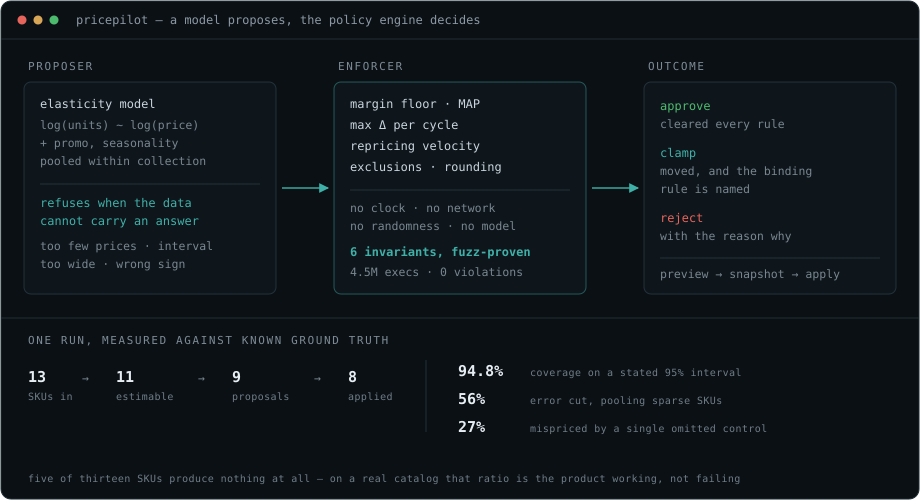

# PricePilot

**An agentic repricing system for Shopify merchants, where a deterministic policy engine holds final authority over every price change.**

<p align="center">
  
</p>


Merchants are right to be afraid of an agent that changes prices. So the product is split in two, and the halves are held to different standards:

- **[`pricing/`](pricing)** is probabilistic. It is judged statistically — does it recover a known elasticity, are its intervals calibrated, does it decline when the data cannot support an answer?
- **[`enforcer/`](enforcer)** is absolute. It is judged by invariants that must hold on every input, proven by fuzzing.

No statistical outcome, however extreme, can produce a price that violates the merchant's policy. That seam is itself tested.

## One run, end to end

```bash
go run ./cmd/pipeline
```

Excerpts from its output (the catalog is synthetic and seeded, so every run prints the same thing):

```
    9 proposals generated; 4 SKUs produced none

      · Chemex Classic 6-cup         sold at 1 distinct price(s); elasticity needs at least 3
      · Hario V60 Filters 100ct      sold at 2 distinct price(s); elasticity needs at least 3
      · Signature Roast Mug          interval [-0.73, -0.38] reaches the inelastic region where no profit-maximising price exists
      · Travel Tumbler 350ml         no unit cost on this variant, so there is no margin to optimise

  funnel:  13 SKUs  →  11 estimable  →  9 proposals  →  8 applied
  of those applied, 4 were held back by a guardrail and 4 took the model's price
  proposals refused outright, by rule:  infeasible_bounds×1
```

Five of thirteen SKUs end with no price change: four never produce a proposal, and one proposal is a cut on a SKU already priced below its margin floor, which the enforcer refuses and reports. On a real catalog that ratio would be far higher, and it is the product working correctly rather than failing. "Applied" here means cleared for the merchant's preview; nothing in this repo writes to a store.

## What is actually proven

| Claim | Evidence |
|---|---|
| The enforcer's seven invariants hold on every input the fuzzer tried | 74.4M fuzz executions in 10 minutes, 0 violations ([details](enforcer/README.md)); 49 discovered corpus entries committed as regression cases |
| Elasticity is recovered from data whose truth is known | 2.0%–6.7% error across four known elasticities (`TestRecoversKnownElasticity`) |
| The confidence intervals mean what they say | 94.8% coverage on a stated 95% interval, over 600 trials |
| Pooling helps thin histories | 56% MSE reduction across 40 sparse SKUs |
| Omitting a confounder has a price | one missing promo control underprices by 26.8% |

## What is not claimed

**No revenue lift.** Proving lift requires a live A/B on a real store, and no number in this repo is one.

**Nothing has touched real merchant data.** The estimator is proven to recover a known β on synthetic orders — which is the only setting where recovery *can* be proven — not to work on real demand, which is non-stationary, cross-elastic, and full of stockouts.

**Nothing auto-applies.** Every run is a preview a merchant approves.

## Layout

```
enforcer/    the guardrail engine — pure, deterministic, fuzzed
pricing/     demand estimation, pooling, proposal generation
cmd/demo     the merchant's review screen
cmd/pipeline the whole chain against known ground truth
PRD.md       product requirements, phases, risks
```

```bash
go test ./...                                                # everything, incl. committed fuzz corpus
go test -run '^$' -fuzz=FuzzDecide -fuzztime=60s ./enforcer  # deep search
```

Phases 1 and 2 of [the PRD](PRD.md) are built. The Shopify app surface (phase 3) extends an existing embedded app for OAuth, `productVariantsBulkUpdate` chunking, and snapshot rollback; it is not built here.
